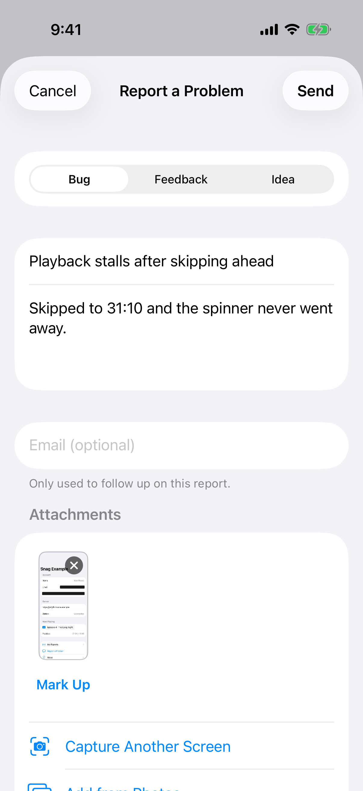
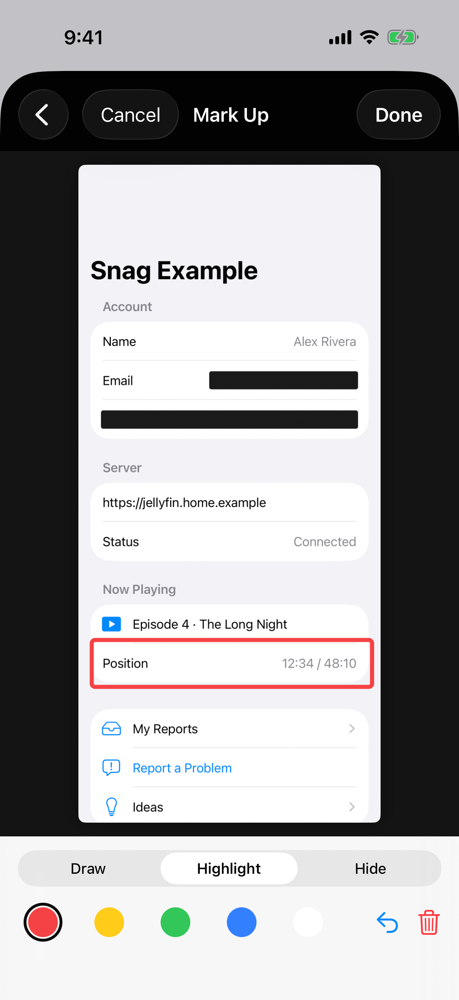
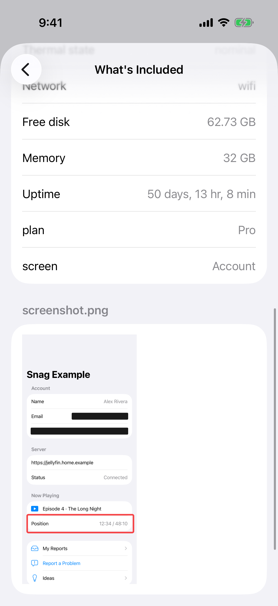
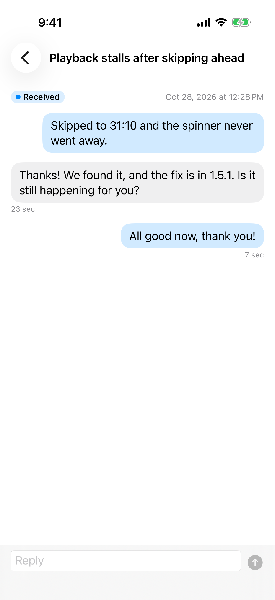
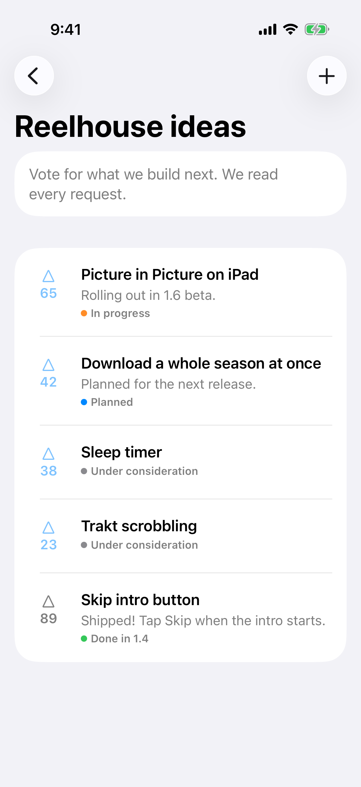
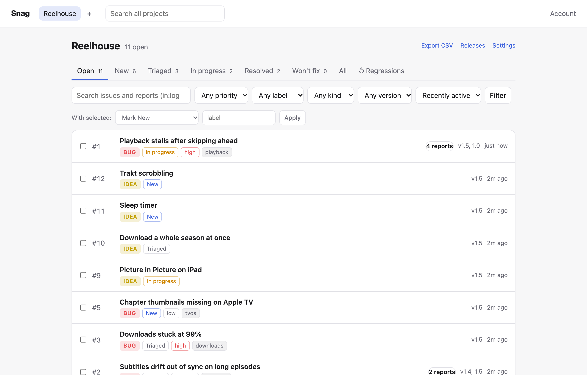
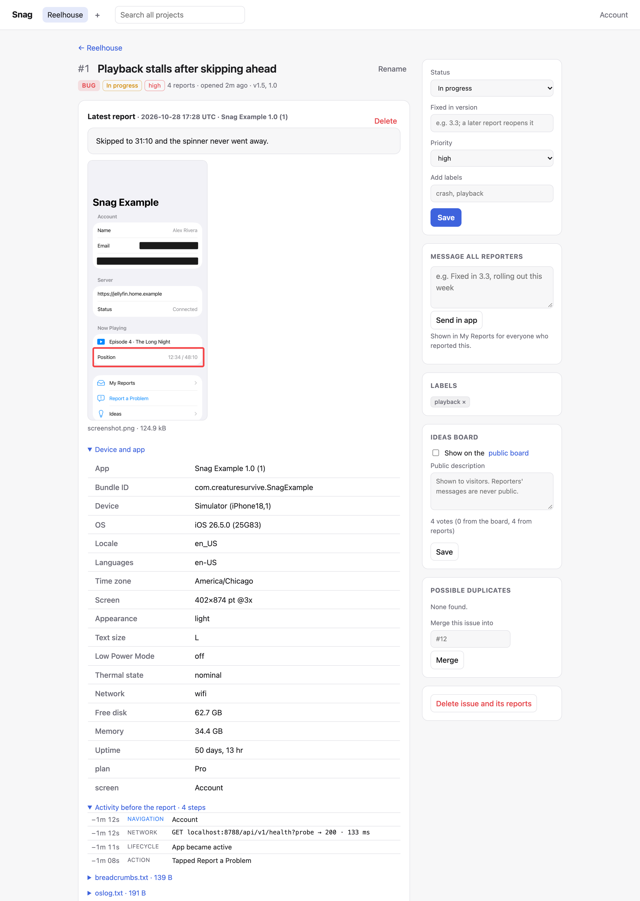
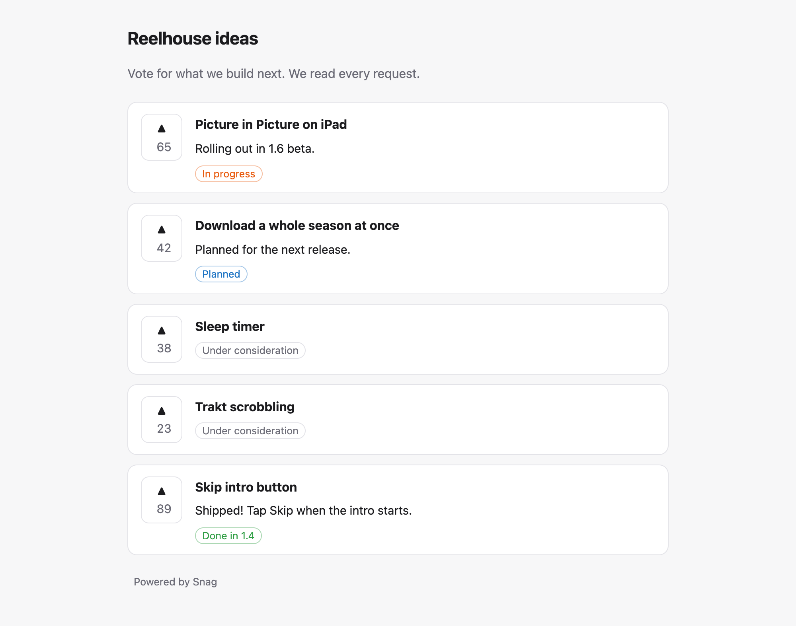

# Snag

[](https://github.com/CreatureSurvive/Snag/actions/workflows/ci.yml)
[](https://swift.org)
[](#requirements)
[](LICENSE)

In-app bug reporting for Apple platforms and the web, plus a self-hosted issue tracker to receive
the reports.

- **Privacy first.** Screenshots and recordings are redacted while they're rendered: views marked
  `.snagPrivate()` and password fields are solid black in the pixels themselves, before anything
  is stored. Tokens, passwords and card numbers are scrubbed from text and logs on the device.
- **Never loses a report.** Reports are written to disk before sending, retried with backoff per
  destination, and survive crashes, relaunches and days offline.
- **Send anywhere.** Your own Snag server, GitHub Issues, Discord, Slack, a signed webhook, or
  email, at the same time.
- **A real tracker on the other end.** One small Docker image (about 12 MB, Go, no dependencies)
  with projects, issue workflow, duplicate grouping, regressions, releases, crash symbolication,
  notifications, two-way GitHub sync, conversations with reporters in the app and by email, a
  public ideas board with votes, and App Attest to reject forged reports.

<p align="center">
  
  
  
  
  
</p>

<picture>
  <source media="(prefers-color-scheme: dark)" srcset="docs/screenshots/dashboard-issues-dark.png">
  
</picture>

```swift
import Snag
import SnagUI

@main
struct MyApp: App {
    let snag = Snag(SnagConfiguration(sinks: [
        SnagServerSink(url: URL(string: "https://snag.example.com")!, apiKey: "snag_…", appAttest: .whenSupported),
    ]))

    var body: some Scene {
        WindowGroup {
            ContentView().snagReporting(snag, triggers: [.shake, .screenshot])
        }
    }
}
```

Shake the device (or take a screenshot, or call `@Environment(\.snagReport)`) and the user gets a
form with a redacted screenshot, markup tools, logs and a preview of exactly what will be sent.

## Contents

- [The app side](#the-app-side): reporting UI, redaction, capture and recording, logs and breadcrumbs, sinks, the outbox, My Reports, ideas, crash reports, App Attest, languages
- [The web](#the-web): the browser SDK
- [The server](#the-server): running it, projects, the tracker, symbols, email replies, the ideas board, forwarding, notifications, GitHub sync, sign-in, backups, storage, metrics, API
- [Testing](#testing), [Requirements](#requirements), [Limitations](#limitations)

## The app side

### Installation

```swift
.package(url: "https://github.com/CreatureSurvive/Snag", from: "1.0.0")
```

| Product | What it is |
| --- | --- |
| `Snag` | Reports, redaction, context and logs, sinks, the outbox, the inbox, App Attest. No UI. |
| `SnagUI` | The SwiftUI report form, screenshot and screen-recording capture, markup editor, My Reports. |
| `SnagPostmortem` | Crash and hang reports from MetricKit via [Postmortem](https://github.com/CreatureSurvive/Postmortem). Optional; it's the only product with a dependency. |

### Reporting UI

`.snagReporting(_:triggers:options:)` adds the form to a view hierarchy (usually the root). Open
it with a shake (iOS), after a system screenshot ("Report a problem with this screen?"), or from
your own button:

```swift
@Environment(\.snagReport) private var report
Button("Report a Problem") { report() }
```

`SnagFormOptions` sets the kinds offered (bug, feedback, idea, or your own), whether to ask for an
email address (prefilled or remembered), extra redaction, tags, and an email fallback. On tvOS the
same form works with the Siri Remote.

### Redaction

```swift
Text(account.email).snagPrivate()        // SwiftUI
passwordLabel.snagIsPrivate = true        // UIKit / AppKit
```

A marked view is tracked by a real view in the hierarchy, so it stays covered through scrolling,
sheets and animation. Password fields (`SecureField`, `isSecureTextEntry`) are always hidden.
`AutomaticRedaction.strict` also hides every text input, web view and video layer. The user can
cover anything else with the Hide tool in the markup editor. All of this is burned into the
pixels before the image is stored anywhere; there's no layer to peel off.

Text is scrubbed by `TextRedactor` before a report is queued: bearer tokens, JWTs,
`password=`/`api_key:` style secrets, private keys, URL credentials and Luhn-valid card numbers
(`.standard`), plus email addresses, phone numbers and IPs (`.strict`). Add your own rules with a
regular expression.

### More screenshots, photos and recordings (iOS)

From the form the user can:

- **Capture another screen.** The form tucks away behind a floating button; go to any screen and
  tap to capture it, redacted the same way. Up to 8 per report.
- **Add from Photos.** Uses the out-of-process picker (no photo library permission). Images are
  re-encoded without EXIF, GPS or camera metadata.
- **Record the problem.** Up to 30 seconds of the app's own windows at 8 fps, redacted in every
  frame. ReplayKit can't do that, so Snag renders frames itself. Typical clips are 50–200 KB.

Snag's own floating controls and the keyboard never appear in captures.

### Context and logs

Each report includes the app version and build, device model, OS, locale, display, accessibility
settings, power, network and storage (choose with `ContextOptions`), plus your own key/value pairs.
Nothing identifying is collected: no device name, vendor ID or IP address.

Log sources: `SnagLog.shared.log("…")` (an in-memory ring buffer), `OSLogSource` (this process's
unified log, no entitlement needed), or `CustomLogSource` for logs you already keep. The user can
turn logs off, and "What's included" shows the exact text that will be sent.

### Breadcrumbs

Reports also carry the last 100 steps before the report, shown on the dashboard as a timeline:

```swift
PlayerView().snagScreen("Player")                       // screens (SwiftUI)
Breadcrumbs.shared.trackViewControllers()               // screens (UIKit, by class name)
Breadcrumbs.shared.action("Tapped Play")                // your own events
try await URLSession.shared.data(for: request, delegate: SnagNetworkObserver.shared)  // requests
```

App foreground and background changes are recorded by `.snagReporting`. Requests keep only the
method, host, path (IDs collapsed to `:id`), query parameter names, status and duration: never
headers, bodies or query values. Breadcrumbs go through the `TextRedactor` like everything else.

### Sinks

| Sink | Notes |
| --- | --- |
| `SnagServerSink` | Your Snag server. Idempotent uploads, follow-up for My Reports, optional App Attest. |
| `GitHubIssuesSink` | Files issues directly. Screenshots can be committed to a branch so they render. |
| `DiscordSink` | Embed plus attachments (screenshots and recordings play inline). |
| `SlackSink` | Text summary (incoming webhooks can't carry files). |
| `WebhookSink` | Multipart or JSON, signed with HMAC-SHA256 (`X-Snag-Signature`). |
| Email | `SnagFormOptions(emailRecipient:)` composes mail with attachments (iOS, visionOS, macOS). |

Any token in an app can be extracted. Prefer `SnagServerSink` and let the server hold GitHub,
Discord and SMTP credentials.

### The outbox

`snag.submit(report)` redacts the report, trims it to the size limit (logs go first), writes it
to disk and returns. Delivery happens in the background: on enqueue, when the network comes back,
and on a backoff schedule. Each sink is tracked separately, so if GitHub is down but your server
isn't, only GitHub is retried. A sink that rejects a report (bad key, too large) isn't retried.
`snag.outbox.events()` streams progress.

### My Reports

```swift
NavigationLink { SnagInboxView(snag: snag) } label: { Label("My Reports", systemImage: "tray") }
```

Every report the user sends is listed with its status from your tracker ("Received", "Being worked
on", "Fixed in 3.3") and the messages you send from the dashboard; the user can reply in the app.
Each report has its own secret, so the app can only read its own reports. `SnagInboxModel`
exposes `unreadCount` for a badge.

### Ideas

```swift
NavigationLink("Ideas") { SnagIdeasView(board: SnagBoard(server: sink)) { report() } }
```

Lists the ideas you publish on the project's [ideas board](#the-ideas-board) with their status
and votes; the user can vote, and "Suggest an Idea" opens your form. `SnagBoard` is the client
underneath if you'd rather build your own UI. Votes are tied to a random ID per install.

### Crash and hang reports

```swift
import SnagPostmortem

let crashes = SnagCrashReporter(snag: snag)                              // files automatically
let crashes = SnagCrashReporter(snag: snag, options: .init(mode: .askUser))
ContentView().snagCrashPrompt(crashes)                                    // "App quit unexpectedly. Send a report?"
crashes.start()
```

MetricKit crash and hang diagnostics become reports with a plain-language explanation, the top app
frame, a symbolicated log and the raw JSON, under the version that crashed. Identical crashes get
the same title and message, so the server groups them into one issue. MetricKit delivers on a
later launch, only on devices, and not on tvOS.

Release builds are stripped, so the device can only name system frames. Upload your dSYMs and the
server [symbolicates](#crash-symbols) the app's frames: function names and source lines, in the
issue title too, so the same crash groups across builds.

### App Attest

`SnagServerSink(…, appAttest: .whenSupported)` attests a Secure Enclave key with your server once,
then signs every upload. With the project set to require verified devices, reports from scripts,
emulators or a stolen key are rejected. The simulator can't attest; reports from it are sent
without a signature, so use "verify and mark" while developing.

### Languages and accessibility

SnagUI and SnagPostmortem ship in English, German, Spanish, French, Japanese, Brazilian Portuguese
and Simplified Chinese. Snag follows your app's languages, so list the ones you support
(`CFBundleLocalizations`, or your own localizations); an English-only app shows Snag in English.
The translations were machine-made and are marked for review in the string catalogs; corrections
are welcome.

The form supports VoiceOver labels, Dynamic Type up to the largest accessibility sizes and Reduce
Motion, and the example app's UI tests run Xcode's accessibility audit on it.

## The web

The server hosts a dependency-free browser SDK:

```html
<script src="https://snag.example.com/sdk/snag.js"></script>
<script>
  Snag.init({ url: "https://snag.example.com", apiKey: "snag_…", app: { name: "My Site", version: "2.1" } })
</script>
```

A Feedback button opens a form (bug, feedback or idea, summary, email). Reports include console
messages, uncaught errors and a breadcrumb trail of pages, clicks and `fetch`/XHR requests, all
redacted with the same rules as the app (`redaction: "strict"` adds emails, phone numbers and
IPs). The user can add a screenshot of the current tab: password and card fields and anything
with `data-snag-private` are blacked out, and sharing a window or screen instead is refused because
its private areas can't be located. Reports made offline wait in `localStorage`.

`Snag.report({ … })` sends without the form, `Snag.breadcrumb(kind, message)` and
`Snag.setContext(key, value)` add context, and `text: { … }` replaces any label. Add the site
under **Web origins** in the project's settings; use a separate ingest key, since it's visible in
the page.

## The server

`Server/` is a Go server with no dependencies, published as a Docker image.

```bash
cd Server && cp .env.example .env    # set SNAG_ADMIN_PASSWORD and SNAG_PUBLIC_URL
docker compose up -d
```

<p align="center">
  
  
</p>

Open the dashboard, create a project and copy its ingest key into `SnagServerSink`. Data lives in
the `/data` volume as plain JSON files plus attachments, so it's easy to back up.

### Configuration

| Variable | Meaning |
| --- | --- |
| `SNAG_ADMIN_PASSWORD` | Dashboard password (user `SNAG_ADMIN_USER`, default `admin`). Unset disables the dashboard. |
| `SNAG_PUBLIC_URL` | How people reach the server; used in links in forwarded reports and notifications. |
| `SNAG_API_KEYS` | Optional: `app:key,app2:key2` creates projects with those keys. |
| `SNAG_PROJECTS_FILE` | Optional: a JSON file of projects (see below). |
| `SNAG_MAX_UPLOAD_MB`, `SNAG_RATE_LIMIT`, `SNAG_RETENTION_DAYS` | Upload size (50), reports per IP per hour (60), days to keep reports (0 = forever). |
| `SNAG_TRUST_PROXY` | `true` behind a reverse proxy, so rate limits see client IPs. |
| `SNAG_GITHUB_TOKEN`, `SNAG_GITHUB_WEBHOOK_SECRET` | Default GitHub token; secret for the sync webhook. |
| `SNAG_SMTP_HOST`, `_PORT`, `_USERNAME`, `_PASSWORD`, `_FROM`, `_REPLY_TO` | Email forwarding and replies to reporters. |
| `SNAG_NTFY_URL`, `SNAG_PUSHOVER_USER`, `SNAG_PUSHOVER_TOKEN`, `SNAG_NOTIFY_PER_HOUR` | Notification defaults. |
| `SNAG_INBOUND_EMAIL_SECRET` | Turns on [email replies from reporters](#email-replies). |
| `SNAG_BACKUP_DIR`, `SNAG_BACKUP_HOURS`, `SNAG_BACKUP_KEEP` | Scheduled [backups](#backups): where, how often (24), how many to keep (7). |
| `SNAG_PROJECT_STORAGE_MB` | Default attachment limit per project (0 = none). |
| `SNAG_S3_BUCKET`, `_ENDPOINT`, `_REGION`, `_ACCESS_KEY_ID`, `_SECRET_ACCESS_KEY`, `_PREFIX` | [S3-compatible storage](#storage) for screenshots and recordings. |
| `SNAG_METRICS_TOKEN` | Bearer token for Prometheus to scrape `/metrics`. |

Every secret can also be read from a file: `SNAG_GITHUB_TOKEN_FILE=/run/secrets/github`.

### Projects

Each project has its own ingest keys (hashed at rest, shown once), issues, forwarding,
notifications and App Attest policy. Create them in the dashboard, or declare them in a file:

```json
{ "projects": [
  { "slug": "gelo", "name": "Gelo", "keys": ["${GELO_KEY}"], "groupDuplicates": true,
    "forwarding": { "github": { "repo": "CreatureSurvive/SwiftJelly", "labels": ["snag"] } },
    "notify": { "ntfy": "https://ntfy.sh/${NTFY_TOPIC}", "onNewIssue": true, "onRegression": true } }
] }
```

Keys in the file are always accepted. The file's other settings seed a project once; after that,
edits in the dashboard win.

### The tracker

- **Issues group reports.** Statuses New, Triaged, In progress, Resolved and Won't fix, plus
  priority, labels and bulk actions.
- **Search.** Every word or `"quoted phrase"` must match the issue, its notes and conversation,
  or its reports' text, contacts, versions and devices; `in:logs` searches logs and crash logs
  too. Search one project or all of them from the header. Save filters as views, and export any
  list as CSV.
- **Keyboard.** `/` search, `j`/`k` move, `o` open, `x` select, `g h` home, `?` for the rest.
- **Duplicates.** Each issue suggests similar ones to merge, and identical reports can be grouped
  automatically. Merged issues redirect.
- **Releases and regressions.** Mark the version a fix ships in. A resolved issue reported again
  on that version or later reopens as a regression; reports from older versions don't. The
  Releases page shows reports per day and what was new and fixed in each version.
- **Notes and activity.** Internal notes, and a history of every change.
- **Replies.** Message one reporter or all of them in the app's My Reports, or reply by email.
  Both land in one conversation per report.
- **Server-side redaction.** The server runs the redaction rules again on everything it receives
  (standard, strict or off per project) and flags reports where the app missed something.

### Crash symbols

Upload dSYMs from CI or an Xcode build phase with a symbol upload token (created under
**Crash symbols** in the project's settings; it can't send reports):

```bash
SNAG_URL=https://snag.example.com SNAG_SYMBOLS_TOKEN=snag_… Scripts/upload-symbols.sh build/MyApp.xcarchive
```

The server reads the DWARF line tables itself (no Xcode needed) and adds a symbolicated log to
crash and hang reports: function names, inlined calls, files and lines for your binaries. Reports
that arrived before their symbols are symbolicated when the symbols are uploaded, and issues show
which builds are missing them.

### Email replies

With SMTP set up, replies from the dashboard go out with a per-report address
(`support+r…@example.com`, from `SNAG_SMTP_REPLY_TO`). Point that mailbox at
`<public URL>/api/v1/inbound-email?key=<SNAG_INBOUND_EMAIL_SECRET>` and the reporter's answer joins
the issue's conversation, with quoted text and signatures removed. It accepts raw messages
(Cloudflare Email Workers), Mailgun and SendGrid form posts, and Postmark's JSON. The tag is signed,
so it can't be forged, and a reply without it is only accepted from the reporter's own address.

### The ideas board

Turn on the board in a project's settings and publish issues to `<public URL>/b/<slug>`: a public
page listing each idea's title, status ("Planned", "In progress", "Done in 3.3") and the
description you write. Reporters' messages and contacts are never shown. Visitors vote once per
browser, apps vote through `SnagBoard`, and reports asking for the same thing count too. Sort the
issue list by votes to see what people want most.

### Forwarding

Each new issue (not each duplicate report) can go to GitHub Issues, Discord, Slack, a signed
webhook and email, with retries that survive restarts.

### Notifications

Push alerts to your phone through [ntfy](https://ntfy.sh) or Pushover for new issues,
regressions, issues raised to high or urgent, or every report. Rules can be limited to some kinds
(for example only crashes), and there's an hourly cap per project.

### GitHub sync

Issues forwarded to GitHub stay in sync both ways. Status (closed as completed or not planned),
labels and priority (`priority: high` labels) go out, and "Fixed in" becomes a comment. Closes,
reopens, label changes and comments come back, the comments as notes. With
`SNAG_GITHUB_WEBHOOK_SECRET`, add a repository webhook (Issues and Issue comments) to
`<public URL>/api/v1/github/webhook` for instant updates. Snag also polls, every 10 minutes
without a webhook or hourly with one.

### Sign-in

The dashboard has a sign-in page with a 30-day session. Add passkeys under **Account** to sign in
with Face ID, Touch ID or a security key (set `SNAG_PUBLIC_URL` to the address you sign in at).
Scripts and the JSON API keep using HTTP Basic auth with the admin password.

### Backups

```bash
docker compose exec -T snag /snag-server backup > snag-backup.tar.gz     # safe while running
docker compose stop snag
docker compose run --rm -v "$PWD:/b" snag restore /b/snag-backup.tar.gz
docker compose start snag
```

A backup is every project, issue, report, attachment and symbol file. Restore into an empty data
directory, `--replace` to set the current data aside, or `--merge` to add a project export (from
a project's settings) to another server. Restores need the server stopped and are checked in a
scratch directory first, so a bad archive changes nothing. `SNAG_BACKUP_DIR` writes one on a
schedule, and the dashboard has a download button.

### Storage

Give projects an attachment limit (per project, or `SNAG_PROJECT_STORAGE_MB` for all). Past it,
new reports are kept without their screenshots and recordings, and the issue says so.

With `SNAG_S3_BUCKET`, screenshots, recordings and other binary attachments move to an
S3-compatible bucket (AWS S3, Cloudflare R2, Backblaze B2, MinIO, SeaweedFS…) after they're
received. Reports, issues and text attachments stay on disk, so search and symbolication stay
fast. The dashboard serves files from the bucket (with ranges, so videos seek), exports include
them, and deleting a report deletes them. Backups don't include the bucket's objects.

### Metrics

`GET /metrics` serves Prometheus metrics: reports received, HTTP requests by route and status,
forwarding attempts, attachments dropped for storage, and gauges for issues by status, reports,
storage per project and pending deliveries. Scrape it with `SNAG_METRICS_TOKEN` or the admin login.

### API

| Endpoint | Auth | Purpose |
| --- | --- | --- |
| `POST /api/v1/reports` | ingest key | Upload (multipart: `report` JSON plus `attachmentN` parts). |
| `GET /api/v1/followup/{id}`, `POST …/messages` | per-report token | Status and thread for My Reports. |
| `POST /api/v1/attest/challenge`, `/keys` | ingest key | App Attest. |
| `GET /api/v1/board`, `POST /api/v1/board/{n}/vote` | ingest key | Ideas board for apps. |
| `POST /api/v1/symbols` | symbol token | Upload a dSYM (zip or DWARF file) as the body. |
| `POST /api/v1/inbound-email` | inbound secret | Reporters' email replies. |
| `GET /sdk/snag.js` | none | The web SDK. |
| `GET /metrics` | metrics token or admin | Prometheus metrics. |
| `GET /api/v1/projects`, `…/{slug}/issues`, `…/issues/{n}` | admin | Read projects and issues. |
| `POST /api/v1/projects/{slug}/issues/{n}/messages` | admin | Message reporters from scripts. |
| `GET /api/v1/health` | none | Health check. |

The dashboard sends a strict Content Security Policy, uses CSRF tokens on every form, and serves
attachments sandboxed. Uploaded images must really be PNG, JPEG, GIF or WebP; SVGs and anything
else are served as downloads.

## Testing

```bash
swift test                    # 73 tests: redaction, sinks, outbox, inbox, breadcrumbs, board, App Attest client, capture, crash reports
cd Server && go test -race ./...   # 61 tests: ingest, tracker, search, symbols, backups, email, board, sign-in, S3, metrics…
node --test Server/internal/server/sdk/snag.test.mjs   # web SDK redaction and URL rules
Scripts/check-strings.py      # string catalogs match the code, every language complete
Scripts/live-test.sh          # Swift client against the real Docker image
Scripts/ui-test.sh            # Example app UI tests against a local server (iOS or tvOS)
Scripts/screenshots/capture.sh   # regenerate docs/screenshots against a fresh demo server
```

To run the example app on a device, set your Team ID when generating the project:
`SNAG_DEVELOPMENT_TEAM=ABCDE12345 xcodegen generate` in `Example/` (simulators don't need it).

The UI tests send reports from the example app to a real server. They check that private areas
are black in the uploaded screenshot's pixels and in a frame decoded from the uploaded recording,
that a developer reply shows up in My Reports and the user's answer reaches the server, and that
the breadcrumb trail arrives. They also open the form in German at the largest text size and run
Xcode's accessibility audit. The S3 test runs against a real S3-compatible server when
`SNAG_TEST_S3_ENDPOINT` and its keys are set (SeaweedFS in Docker works).

## Requirements

- Swift 6.1+ (Xcode 16.4+). iOS 17, macOS 14, tvOS 17, visionOS 1.
- Docker, or Go 1.22+, for the server.

## Limitations

- Capturing more screens and recording are iOS only. tvOS gets the current screen.
- visionOS builds in CI but hasn't been run on a device or simulator.
- App Attest needs a real device; the server-side verification is tested with a synthetic
  certificate chain, not yet with a genuine Apple attestation.
- MetricKit reports can't be produced in the simulator; the crash reporter is tested with payloads
  generated by MetricKit, and server symbolication with a dSYM built in the tests' fixtures.
- Swift function names come from DWARF, so they read `ContentView.load` without argument labels.
- The web SDK's tab screenshot needs a browser with `getDisplayMedia` and a user click, so it
  isn't covered by the automated tests and hasn't been tried in a real browser yet. Passkey
  sign-in is tested with a software authenticator, not a real one.
- Email replies are tested with sample Mailgun, Postmark and raw messages, not live accounts.
- The server keeps everything in memory and on disk as files: comfortable for thousands of
  reports per project, not millions.
